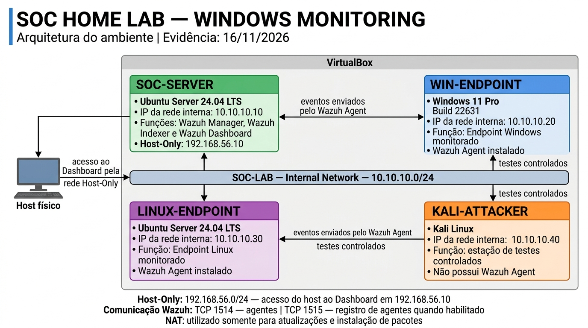

# SOC Home Lab — Windows Endpoint Monitoring


## Sobre o Projeto

Este diretório documenta exclusivamente o monitoramento de segurança do endpoint
Windows do SOC Home Lab. O objetivo é demonstrar a integração do Windows 11 Pro
com o Wazuh Agent e a coleta de eventos do Windows Event Log para análise
centralizada no Wazuh.

As atividades são executadas na rede isolada `SOC-LAB`, conforme a arquitetura
oficial do laboratório, sem exposição dos testes a sistemas externos.

## Ambiente Windows

| Componente | Sistema Operacional | IP na rede interna | Função |
| :--- | :--- | :--- | :--- |
| **SOC-SERVER** | Ubuntu Server 24.04 LTS | `10.10.10.10` | Wazuh Manager, Indexer e Dashboard |
| **WIN-ENDPOINT** | Windows 11 Pro (Build 22631) | `10.10.10.20` | Endpoint monitorado |

O acesso ao Dashboard é realizado pela interface Host-Only do `SOC-SERVER`,
em `https://192.168.56.10`. A comunicação do agente utiliza a porta TCP
`1514`; a porta TCP `1515` é utilizada para registro de agentes quando esse
mecanismo estiver habilitado.

## Objetivos do Monitoramento

- Integrar o `WIN-ENDPOINT` ao Wazuh;
- Coletar eventos dos canais `Security` e `System`;
- Monitorar autenticações e falhas de logon;
- Monitorar criação de processos;
- Monitorar criação de usuários e alterações em grupos locais;
- Validar a chegada e a decodificação dos eventos no Dashboard.

## Configuração do Wazuh Agent

O agente Windows é configurado no arquivo:

```text
C:\Program Files (x86)\ossec-agent\ossec.conf
```

Os canais coletados são:

```xml
<localfile>
  <location>Security</location>
  <log_format>eventchannel</log_format>
</localfile>

<localfile>
  <location>System</location>
  <log_format>eventchannel</log_format>
</localfile>
```

O agente se comunica com o Wazuh Manager em `10.10.10.10:1514/TCP`.

## Auditoria de Eventos Windows

O script de auditoria habilita as políticas necessárias para gerar eventos
controlados no endpoint:

| Event ID | Atividade |
|---:|---|
| `4688` | Criação de processo |
| `4624` | Logon bem-sucedido |
| `4625` | Falha de logon |
| `4720` | Criação de usuário |
| `4732` | Inclusão em grupo local |

Os eventos são coletados pelo agente e disponibilizados no Wazuh para consulta
e validação. A presença de um evento não representa, isoladamente, a
confirmação de um incidente.

## Evidências Visuais

### 01 — Arquitetura e Gerenciamento do VirtualBox

Visão do ambiente virtualizado com o `WIN-ENDPOINT` integrado à rede interna
`SOC-LAB`.



### 02 — Monitoramento de Criação de Processos

Evento `4688` visualizado no Windows Event Viewer e recebido pelo Wazuh.


### 03 — Monitoramento de Eventos de Segurança

Evento `4625` visualizado no Wazuh como falha de logon do Windows.


## Scripts de Apoio

Os arquivos diretamente relacionados ao monitoramento Windows estão disponíveis
em [`scripts`](./scripts):

- [`01-wazuh-agent-config.xml`](./scripts/01-wazuh-agent-config.xml): configuração do agente e dos canais coletados;
- [`02-windows-command-audit.ps1`](./scripts/02-windows-command-audit.ps1): habilitação da auditoria e geração de eventos controlados.

