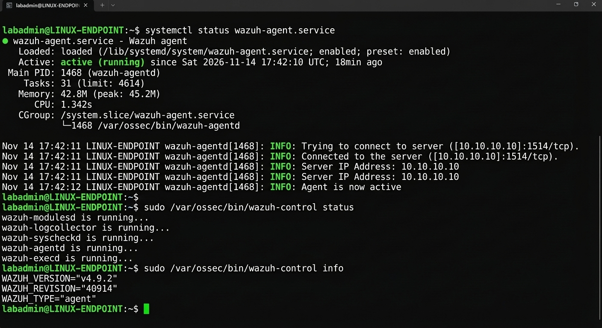
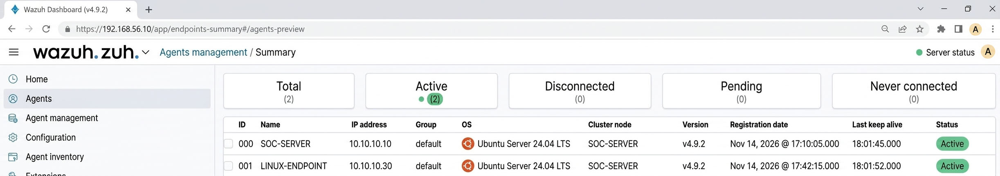
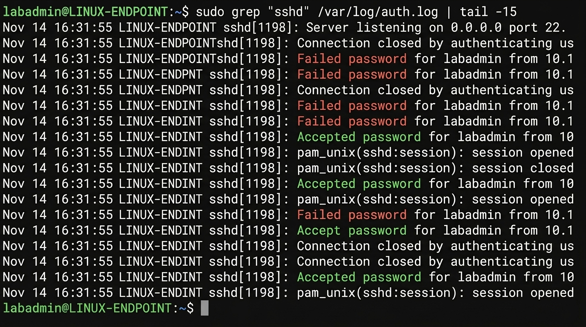
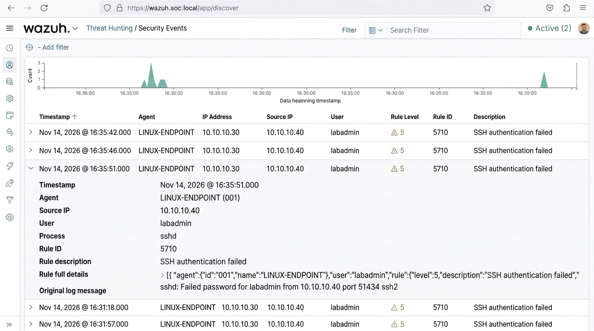
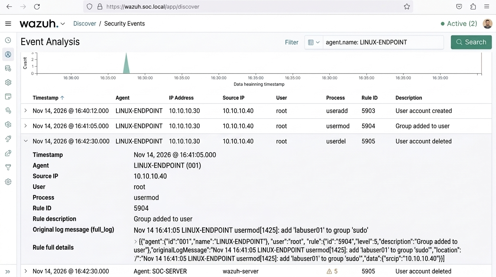
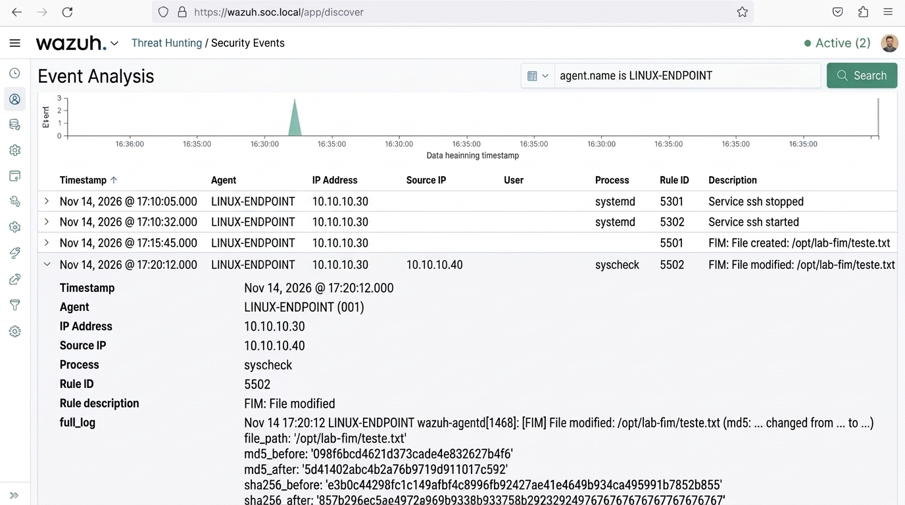

# SOC Home Lab — Linux Endpoint Monitoring


## Sobre o Projeto

Este diretório documenta exclusivamente o monitoramento de segurança do
`LINUX-ENDPOINT` do SOC Home Lab. O objetivo é demonstrar a integração do
Ubuntu Server 24.04 LTS com o Wazuh Agent e a coleta de eventos Linux pelo
Wazuh Manager.

O módulo cobre autenticação, atividades administrativas, processos, serviços,
logs do sistema e integridade de arquivos. A arquitetura geral do laboratório
está documentada em [`01-Architecture`](../01-Architecture).

## Ambiente Linux

| Componente | Sistema Operacional | IP na rede interna | Função |
| :--- | :--- | :--- | :--- |
| **SOC-SERVER** | Ubuntu Server 24.04 LTS | `10.10.10.10` | Wazuh Manager, Indexer e Dashboard |
| **LINUX-ENDPOINT** | Ubuntu Server 24.04 LTS | `10.10.10.30` | Endpoint Linux monitorado |

O `LINUX-ENDPOINT` comunica-se com o Wazuh Manager pela rede interna
`SOC-LAB` (`10.10.10.0/24`) utilizando a porta TCP `1514`. A porta TCP
`1515` é utilizada para registro de agentes quando esse mecanismo estiver
habilitado.

O acesso administrativo ao Dashboard ocorre pela interface Host-Only do
`SOC-SERVER`, em `https://192.168.56.10`. A rede Host-Only não substitui a rede
interna utilizada na comunicação entre os agentes e o Manager.

## Objetivos do Monitoramento

- Integrar o `LINUX-ENDPOINT` ao Wazuh;
- Coletar logs de autenticação e atividades administrativas;
- Monitorar autenticações SSH bem-sucedidas e malsucedidas;
- Registrar atividades executadas com `sudo`;
- Acompanhar processos e serviços do sistema;
- Monitorar alterações em arquivos e diretórios com FIM;
- Validar a chegada dos eventos ao Wazuh Manager.

## Implantação do Wazuh Agent

O agente é instalado no `LINUX-ENDPOINT` a partir do repositório oficial do
Wazuh. O procedimento completo de configuração do repositório, instalação e
validação está no script
[`install-wazuh-agent.sh`](./scripts/install-wazuh-agent.sh).

Após configurar o repositório oficial, a instalação utiliza:

```bash
sudo WAZUH_MANAGER='10.10.10.10' \
  WAZUH_AGENT_NAME='LINUX-ENDPOINT' \
  apt install -y wazuh-agent
```

Após a instalação:

```bash
sudo systemctl daemon-reload
sudo systemctl enable wazuh-agent
sudo systemctl start wazuh-agent
sudo systemctl status wazuh-agent
sudo /var/ossec/bin/wazuh-control status
```

O agente deve aparecer no Wazuh Dashboard com o nome `LINUX-ENDPOINT` e estado
`Active`.

## Coleta de Logs

A configuração é aplicada no arquivo:

```text
/var/ossec/etc/ossec.conf
```

As fontes de eventos monitoradas são:

```xml
<localfile>
  <log_format>syslog</log_format>
  <location>/var/log/auth.log</location>
</localfile>

<localfile>
  <log_format>syslog</log_format>
  <location>/var/log/syslog</location>
</localfile>

<localfile>
  <log_format>full_command</log_format>
  <command>ps aux</command>
  <frequency>300</frequency>
</localfile>
```

O arquivo `auth.log` registra autenticações SSH, atividades `sudo` e eventos
relacionados ao gerenciamento de usuários. O arquivo `syslog` complementa a
coleta com eventos de serviços e atividades do sistema. A listagem `ps aux` é
coletada a cada 300 segundos.

Após alterações na configuração:

```bash
sudo systemctl restart wazuh-agent
```

## Autenticação SSH

O monitoramento SSH permite identificar acessos bem-sucedidos e falhos ao
`LINUX-ENDPOINT`.

Exemplo de autenticação:

```bash
ssh <usuario>@10.10.10.30
```

Registros relevantes em `/var/log/auth.log` incluem:

```text
Accepted password
Failed password
```

Os eventos podem conter usuário, origem, horário, serviço e resultado da
autenticação. Múltiplas falhas devem ser analisadas conforme a correlação e as
regras efetivamente aplicadas no Wazuh; três falhas isoladas não comprovam, por
si só, um ataque de força bruta.

## Usuários e Atividades Administrativas

O monitoramento Linux contempla operações controladas de administração,
incluindo:

```bash
sudo useradd -m -s /bin/bash labuser01
sudo usermod -aG sudo labuser01
sudo userdel -r labuser01
sudo systemctl restart ssh
```

As atividades `useradd`, `usermod`, `userdel`, `passwd` e `sudo` podem ser
identificadas nos registros de autenticação e encaminhadas ao Wazuh para
análise.

A inclusão de uma conta em um grupo administrativo deve ser interpretada no
contexto da atividade autorizada. Ela não representa automaticamente uma
elevação maliciosa de privilégio.

## Processos e Serviços

O monitoramento de processos utiliza a coleta periódica de `ps aux`. A
verificação local dos serviços pode ser realizada com:

```bash
systemctl status ssh
systemctl status wazuh-agent
```

Alterações controladas no estado do serviço SSH podem ser observadas nos logs
do sistema e encaminhadas ao Wazuh:

```bash
sudo systemctl stop ssh
sudo systemctl start ssh
```

## File Integrity Monitoring

O FIM monitora os diretórios definidos na configuração do agente:

```xml
<syscheck>
  <frequency>300</frequency>
  <directories check_all="yes">/etc</directories>
  <directories check_all="yes">/opt/lab-fim</directories>
</syscheck>
```

O diretório `/etc` representa arquivos de configuração do sistema e dos
serviços. O diretório `/opt/lab-fim` é uma área controlada para validação:

```bash
sudo mkdir -p /opt/lab-fim
echo "conteudo inicial" | sudo tee /opt/lab-fim/teste.txt
echo "conteudo alterado" | sudo tee /opt/lab-fim/teste.txt
```

Os eventos de criação e alteração podem ser consultados no Wazuh Dashboard na
área de File Integrity Monitoring.

## Evidências Visuais

### 01 — Agente Linux

Validação do serviço do Wazuh Agent no `LINUX-ENDPOINT`.



### 02 — Status do Agente no Dashboard

Visualização do agente Linux no Wazuh Dashboard.



### 03 — Logs de Autenticação

Eventos de autenticação coletados do endpoint Linux.



### 04 — Falha de Login

Evidência de tentativa malsucedida de autenticação SSH.



### 05 — Gerenciamento de Usuários

Evidência de atividade relacionada ao gerenciamento de usuários Linux.



### 06 — Atividade Sudo

Evidência de execução de comandos administrativos.


### 07 — Monitoramento do Sistema

Evidência de processos e serviços do endpoint Linux.



## Scripts de Apoio

Os arquivos diretamente relacionados ao monitoramento Linux estão disponíveis
em [`scripts`](./scripts):

- [`install-wazuh-agent.sh`](./scripts/install-wazuh-agent.sh): instalação e validação do agente;
- [`ossec-localfile.conf`](./scripts/ossec-localfile.conf): coleta de logs e processos;
- [`ossec-syscheck.conf`](./scripts/ossec-syscheck.conf): configuração do FIM.
