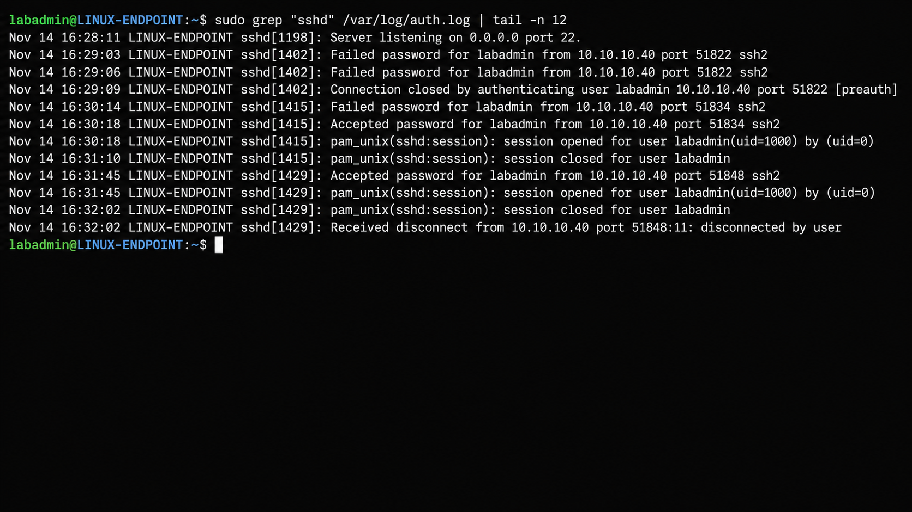
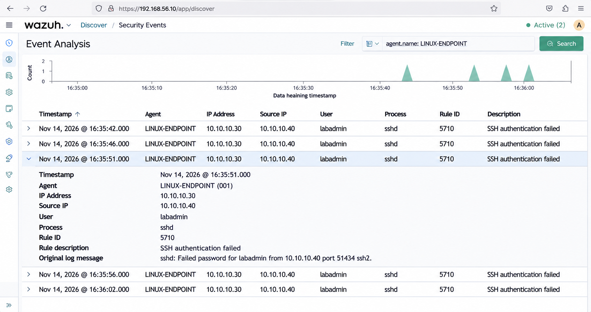

# SOC Home Lab — Brute Force Detection


## Sobre o cenário

Este módulo documenta a detecção e a triagem de tentativas repetidas de
autenticação SSH no laboratório SOC Home Lab. O cenário utiliza somente as
máquinas e a rede definidas em
[`01-Architecture`](../01-Architecture):

- `KALI-ATTACKER` (`10.10.10.40`) gera as tentativas controladas;
- `LINUX-ENDPOINT` (`10.10.10.30`) recebe as conexões SSH;
- `SOC-SERVER` (`10.10.10.10`) recebe e analisa os eventos por meio do Wazuh;
- a comunicação ocorre pela rede interna `SOC-LAB` (`10.10.10.0/24`);
- o acesso ao Dashboard é feito pelo host físico em
  `https://192.168.56.10`.

O objetivo é demonstrar o fluxo de um analista SOC N1: gerar uma atividade
autorizada, confirmar o log de origem, localizar o alerta no SIEM, avaliar o
contexto, classificar o achado e registrar uma resposta proporcional.

## Escopo e limites

Este módulo cobre:

- falhas de autenticação SSH;
- origem, destino, usuário, horário e porta da conexão;
- correlação temporal de várias tentativas;
- triagem de alertas e distinção entre atividade autorizada, suspeita e
  incidente;
- associação justificada ao MITRE ATT&CK;
- recomendação de resposta e escalonamento.

Este módulo não implementa bloqueio automático, SOAR, IDS dedicado, análise de
malware ou ataque contra sistemas externos. O Kali é utilizado somente para
testes autorizados dentro da rede do laboratório.

## Fluxo técnico

```text
KALI-ATTACKER (10.10.10.40)
        |
        | SSH/TCP 22 — tentativas controladas
        v
LINUX-ENDPOINT (10.10.10.30)
        |
        | Wazuh Agent/TCP 1514
        v
SOC-SERVER (10.10.10.10)
        |
        | Wazuh Manager -> Indexer -> Dashboard
        v
Host físico via Host-Only (192.168.56.10)
```

O tráfego de telemetria utiliza a rede interna `SOC-LAB`. A rede Host-Only
serve apenas para o acesso do host físico ao Dashboard e não é utilizada pelo
endpoint Linux para enviar eventos ao Manager.

## Pré-requisitos

Antes do teste, confirme:

1. O serviço SSH está ativo no `LINUX-ENDPOINT`:

   ```bash
   sudo systemctl status ssh
   ```

2. O Wazuh Agent está ativo no `LINUX-ENDPOINT`:

   ```bash
   sudo systemctl status wazuh-agent
   ```

3. O agente está registrado no Manager com o nome `LINUX-ENDPOINT`.
4. O arquivo `/var/ossec/etc/ossec.conf` coleta `/var/log/auth.log`.
5. O `KALI-ATTACKER` alcança `10.10.10.30:22` pela rede `SOC-LAB`.
6. O horário dos sistemas está sincronizado o suficiente para correlação.

## Execução controlada

No `KALI-ATTACKER`, execute tentativas manuais contra o usuário de teste
existente no `LINUX-ENDPOINT` e utilize deliberadamente uma senha incorreta.
Force autenticação por senha para evitar que uma chave válida produza um
resultado diferente:

```bash
ssh -o PreferredAuthentications=password \
    -o PubkeyAuthentication=no \
    labadmin@10.10.10.30
```

Repita o procedimento em uma janela curta, por exemplo, cinco tentativas em
até dois minutos. Não utilize credenciais reais nem teste endereços fora da
rede `SOC-LAB`.

Depois de gerar as falhas, confirme a origem no endpoint:

```bash
sudo grep "sshd" /var/log/auth.log | tail -n 20
```

As linhas esperadas devem conter `Failed password`, o usuário testado, a
origem `10.10.10.40`, a porta de origem e o serviço `sshd`. A mensagem local é
a evidência primária; o alerta do Wazuh deve ser comparado a ela.

## Validação no Wazuh

No Dashboard, acesse a área de eventos e filtre pelo agente
`LINUX-ENDPOINT`. Em seguida, restrinja a busca aos eventos de autenticação
SSH conforme os campos efetivamente disponíveis na versão instalada.

Registre, sem inventar valores:

| Campo | Valor esperado no cenário |
|---|---|
| Agente | `LINUX-ENDPOINT` |
| IP do agente | `10.10.10.30` |
| Origem | `10.10.10.40` |
| Serviço | `sshd` |
| Protocolo | SSH/TCP |
| Porta de destino | `22` |
| Usuário | usuário de teste utilizado |
| Resultado | falha de autenticação |
| Horário | compatível entre `auth.log` e Dashboard |
| Regra e nível | registrar o valor exibido pelo Wazuh |

O identificador e o nível da regra devem ser copiados do alerta observado,
porque podem variar conforme a versão do Wazuh e o ruleset instalado. A
evidência atual do módulo Linux apresenta eventos de falha SSH com a regra
exibida no Dashboard, mas uma regra individual não deve ser apresentada
automaticamente como prova de brute force.

## Evidências Visuais

### Log local de autenticação SSH

Confirma as mensagens de autenticação no `LINUX-ENDPOINT`, incluindo origem,
usuário e resultado da tentativa.



### Alertas de falha SSH no Wazuh

Confirma a chegada dos eventos ao Wazuh com o agente, IP do endpoint, origem,
usuário, regra e mensagem original.



## Triagem N1

A classificação deve considerar o conjunto de eventos, não apenas uma linha:

1. Confirme se as falhas ocorreram em uma janela curta.
2. Compare o IP de origem com a atividade autorizada no Kali.
3. Verifique se houve autenticação bem-sucedida depois das falhas.
4. Confirme o usuário, o endpoint e a porta de destino.
5. Procure eventos relacionados no `auth.log` e no Dashboard.
6. Registre a regra, o nível e a severidade analítica separadamente.
7. Classifique o resultado como:
   - **Atividade autorizada:** teste planejado e confirmado;
   - **Suspeita:** padrão anômalo sem confirmação de comprometimento;
   - **Incidente:** atividade não autorizada com evidência suficiente.

Cinco falhas geradas pelo próprio Kali demonstram o mecanismo de detecção, mas
não representam um incidente real. A conclusão deve declarar que a atividade
foi autorizada e controlada.

## Investigação e evidências

Para cada execução, registre:

- ID interno do teste;
- data e hora inicial e final;
- agente afetado;
- IP de origem e destino;
- usuário testado;
- quantidade de falhas;
- intervalo entre as tentativas;
- regra e nível exibidos pelo Wazuh;
- trechos correspondentes de `/var/log/auth.log`;
- existência ou ausência de sucesso posterior;
- classificação e justificativa;
- limitações da análise.

Uma evidência mínima deve relacionar a linha do `auth.log` ao evento
correspondente no Dashboard. Não use uma captura com URL, IP, hostname ou
horário diferente do ambiente oficial.

## MITRE ATT&CK

Quando o padrão observado for compatível com tentativa de adivinhação de
senha, o comportamento pode ser associado a:

- **T1110 — Brute Force**;
- **T1110.001 — Password Guessing**, quando a evidência demonstrar tentativas
  de senha.

O mapeamento é uma contextualização do comportamento observado, não uma prova
de comprometimento. A justificativa deve citar as falhas repetidas, a janela de
tempo, a origem e o usuário envolvidos.

## Resposta recomendada

Para uma atividade autorizada, a ação é documentar o teste e encerrar a
triagem como atividade esperada.

Para uma origem não autorizada, recomendar, conforme aprovação e procedimento
do laboratório:

- validar o proprietário da conta;
- preservar os logs;
- revisar autenticações bem-sucedidas posteriores;
- aplicar bloqueio temporário da origem no endpoint ou no controle de rede;
- reforçar a proteção da conta;
- escalar o caso se houver evidência de acesso bem-sucedido ou persistência.

Nenhuma dessas ações deve ser descrita como executada se apenas foi
recomendada.

## Limitações conhecidas

- O cenário demonstra detecção baseada em eventos SSH, não análise completa de
  rede.
- A coleta de `auth.log` registra autenticações, mas não prova a intenção do
  operador.
- Uma falha isolada não caracteriza brute force.
- A regra exibida pode mudar conforme a versão do Wazuh.
- A ausência de alerta não prova ausência de atividade se o agente, a coleta ou
  a regra estiverem configurados incorretamente.
- O cenário não substitui autenticação centralizada, MFA ou controles de
  produção.

## Referências do laboratório

- [`01-Architecture`](../01-Architecture): componentes, redes, IPs e portas;
- [`03-Linux-Monitoring`](../03-Linux-Monitoring): agente, `auth.log`,
  evidências SSH e configuração de coleta;
- [`02-Windows-Monitoring`](../02-Windows-Monitoring): eventos Windows de
  falha de logon, mantidos como evidência específica do endpoint Windows.
